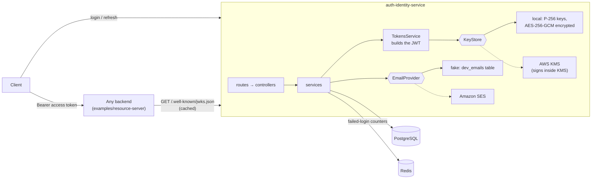
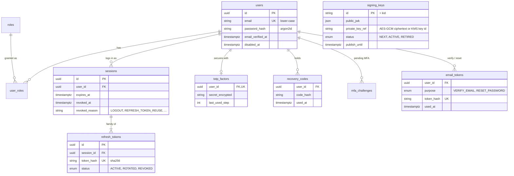

# auth-identity-service

A standalone identity service that other backends trust. Users register, verify their email, log in (optionally with TOTP), refresh and log out. The service issues short-lived **ES256 access tokens** that any backend can verify using only the public keys at `/.well-known/jwks.json`.

The interesting parts:

- **Refresh-token rotation with reuse detection.** Presenting an already-used refresh token revokes the whole login.
- **Signing-key rotation.** No valid token ever fails verification: the next key is published before it signs, and old keys are kept until their tokens expire.
- **TOTP MFA** with replay protection and hashed recovery codes.
- **Login throttling** whose responses never reveal whether an email has an account.

**What runs where:** everything runs locally with Docker, with no cloud account. Signing keys live in Postgres, encrypted with a key from the environment. Email goes to a database table that a dev-only endpoint can read. An **AWS KMS** key store and an **Amazon SES** email provider sit behind the same interfaces but are not exercised by the tests. The project is **not deployed**.

**Stack:** Node 24, TypeScript (strict), Express 5, Prisma 7, PostgreSQL 16, Redis 7 (login throttling only), Zod, `@node-rs/argon2`, `jose`, Jest + Supertest, ESLint + Prettier.

## Architecture



Dashed lines are the AWS providers, selected with `KEY_STORE=kms` and `EMAIL_PROVIDER=ses`.

```
src/
  common/      config, logger, errors + handler, validate, pagination, auth middleware (JWT +
               live-session check, role guard), crypto (AES-GCM, token hashing), passwords (argon2id),
               db, redis, base repository, response helpers
  providers/   key-store/ (local, KMS, factory)    email/ (fake, SES, factory)
  modules/     users, sessions (+ login throttle), tokens, mfa (+ TOTP), email-verification,
               password-reset, roles, admin, dev-emails
  container.ts composition root          app.ts / server.ts  HTTP API
examples/resource-server/   a backend that trusts tokens through the JWKS URL only (55 lines)
scripts/       start-with-secrets.ts, rotate-signing-key.ts, grant-role.ts, login-latency.ts
tests/         unit/, integration/ (real Postgres + Redis)
```

Each module has `routes → controller → service → repository` plus its own Zod `schemas`.

## Data model



Partial unique indexes allow at most one ACTIVE and one NEXT signing key. `mfa_challenges`, `roles`/`user_roles` and `dev_emails` are left out of the diagram for brevity.

## Run it

Requires Docker.

```bash
cp .env.example .env      # contains a published dev-only KEY_ENCRYPTION_KEY: never use it elsewhere
docker compose up --build
```

This starts Postgres (host port **5448**) and Redis (**6383**), runs migrations and seeds the `user` and `admin` roles, then starts the API on <http://localhost:3000>.

```bash
J='Content-Type: application/json'
curl -s localhost:3000/users -H "$J" -d '{"email":"ada@example.com","name":"Ada","password":"correct horse battery staple"}'

# The fake email provider stores mail; read the verification link (dev only)
TOKEN=$(curl -s "localhost:3000/dev/emails?to=ada@example.com" | jq -r '.data[0].text' | grep -o 'token=[^ ]*' | cut -d= -f2)
curl -s localhost:3000/email-verification/confirm -H "$J" -d "{\"token\":\"$TOKEN\"}"

PAIR=$(curl -s localhost:3000/auth/login -H "$J" -d '{"email":"ada@example.com","password":"correct horse battery staple"}')
AT=$(echo $PAIR | jq -r .data.accessToken); RT=$(echo $PAIR | jq -r .data.refreshToken)
curl -s localhost:3000/users/me -H "Authorization: Bearer $AT"
curl -s localhost:3000/.well-known/jwks.json

curl -s localhost:3000/auth/refresh -H "$J" -d "{\"refreshToken\":\"$RT\"}"   # new pair
curl -s localhost:3000/auth/refresh -H "$J" -d "{\"refreshToken\":\"$RT\"}"   # reuse: 401, session revoked

# The first admin: npm run admin:grant -- ada@example.com admin   (then log in again)
```

The example resource server verifies tokens with nothing but the JWKS URL:

```bash
JWKS_URL=http://localhost:3000/.well-known/jwks.json npm run example:resource-server
curl -s localhost:4000/notes -H "Authorization: Bearer $AT"
```

### Tests and lint

```bash
docker compose up -d postgres redis   # tests use the identity_test database and Redis db 1
npm ci
npm run lint
npm test                              # unit + integration
```

## Endpoints

Every response uses one envelope: `{ "data": … }`, plus `"meta": { page, pageSize, total, totalPages }` on lists. Errors are `{ "error": { "code", "message", "details"? } }`. The JWKS document is the exception: it is served bare, because that is the format JWT libraries read. Every list takes `?page=&pageSize=`. All input is validated.

| Method | Path                                                             | Access       | Notes                                                                  |
| ------ | ---------------------------------------------------------------- | ------------ | ---------------------------------------------------------------------- |
| GET    | `/health`, `/.well-known/jwks.json`                              | public       | JWKS: NEXT, ACTIVE and in-window RETIRED keys                          |
| POST   | `/users`                                                         | public       | Always 202 with the same body                                          |
| GET    | `/users/me` · PATCH `/users/me`                                  | user         |                                                                        |
| POST   | `/users/me/password`                                             | user         | Needs the current password; signs out other sessions                   |
| POST   | `/auth/login`                                                    | public       | Tokens, or `{mfaRequired, mfaToken}`; throttled (429 + `Retry-After`)  |
| POST   | `/auth/login/mfa`                                                | public       | `{mfaToken, code}` or `{mfaToken, recoveryCode}`; 5 attempts           |
| POST   | `/auth/refresh`                                                  | public       | Rotates the refresh token; reuse revokes the session                   |
| POST   | `/auth/logout`                                                   | user         |                                                                        |
| GET    | `/sessions` · DELETE `/sessions/:id`                             | user         | Own sessions only; the current one is flagged                          |
| POST   | `/email-verification/confirm`                                    | public       | Single-use token, 24 h                                                 |
| POST   | `/email-verification/resend`                                     | user         | 409 if already verified                                                |
| POST   | `/password-reset/request`                                        | public       | Always 202; invalidates older links                                    |
| POST   | `/password-reset/confirm`                                        | public       | Single-use token, 30 min; signs out every session                      |
| POST   | `/mfa/totp/enroll`                                               | user         | Secret + `otpauth://` URI                                              |
| POST   | `/mfa/totp/activate`                                             | user         | `{code}`; returns 10 recovery codes once                               |
| POST   | `/mfa/totp/disable` · `/mfa/recovery-codes`                      | user         | Need a fresh code                                                      |
| GET    | `/roles` · POST `/roles`                                         | user · admin |                                                                        |
| GET    | `/admin/users`                                                   | admin        | `?email=` filter                                                       |
| POST   | `/admin/users/:id/roles` · DELETE `/admin/users/:id/roles/:role` | admin        | Shows up in the token at the next refresh                              |
| POST   | `/admin/users/:id/disable` · `/enable`                           | admin        | Disabling revokes every session                                        |
| GET    | `/admin/keys` · POST `/admin/keys/rotate`                        | admin        | Private key references are never returned                              |
| GET    | `/dev/emails`                                                    | public, dev  | Only when `DEV_ENDPOINTS=true`, which requires the fake email provider |

## Key design decisions

**Refresh tokens are a family, and reuse kills the family.** Each refresh token is 256 random bits, given to the client once and stored as SHA-256. A login (a `session`) is the family. `POST /auth/refresh` marks the presented token ROTATED with a compare-and-set (`WHERE status = 'ACTIVE'`) and issues a successor in the same session.

If a ROTATED token is presented again, two parties hold copies: maybe a thief, maybe the user, and the service can't tell which. So `SessionsService.refresh` revokes the session and every token in it, and logs the event. Losing the compare-and-set to a simultaneous request counts the same way. That strict choice means a client that double-submits a refresh gets logged out (see limitations). `tests/integration/refresh-tokens.test.ts` proves that after a reuse the newest token fails too, while other sessions survive.

**Access tokens are verifiable by anyone, and revocable here.** Access tokens are ES256 JWTs (`iss`, `aud`, `sub`, `sid`, `roles`, `email_verified`, 15 minutes) with a `kid` header. `TokensService` assembles the JWT itself and only asks the `KeyStore` for the signature, so the local and KMS key stores work identically. KMS returns DER signatures, which `derToJose()` converts to JOSE's raw r‖s; a unit test checks the conversion on 50 signatures.

This service's own endpoints also check that the token's session is still live, so logout, password changes and admin disables take effect here immediately. Other backends rely on the 15-minute lifetime.

**Key rotation with nothing ever failing to verify.** Keys move NEXT → ACTIVE → RETIRED:

- **NEXT keys are published before they are used.** JWKS clients rate-limit refetches (jose waits 30 s after a fetch), so a key published at the moment it starts signing would be rejected by resource servers for a while. The first version of this service did exactly that, and the resource-server test caught it.
- **A retired key stays in the JWKS until `now + access-token TTL + 60 s`,** by which time every token it signed has expired.

The test signs a token, lets the resource server cache the JWKS, rotates, and then verifies both the old token and a new one without the resource server refetching.

**Login answers never reveal whether an account exists:**

- An unknown email, a wrong password and a disabled account all get the same 401 body.
- Unknown emails are checked against a dummy argon2 hash, so timing matches.
- Registration always returns 202. An existing owner gets a "someone tried to register" email instead of a second account.

**Throttling in Redis.** Failures are counted per email hash and per IP with `INCR` and `EXPIRE … NX` (fixed windows). At the limit the endpoint returns 429 with `Retry-After`, including for emails that have no account.

**Passwords use argon2id** with the OWASP minimum parameters (19 MiB memory, 2 iterations, 1 lane), via `@node-rs/argon2` (prebuilt binaries, so there is no native build step in Docker). Passwords are 12–128 characters; length is the rule that matters (NIST 800-63B).

**TOTP written out by hand** (`src/modules/mfa/totp.ts`, about 60 lines), checked against the RFC 6238 test vectors:

- **Clock drift:** one 30-second step either side is accepted.
- **No replay:** the last accepted step is stored, and a code for that step or an earlier one is refused, through a compare-and-set.
- **At rest:** secrets are encrypted with AES-256-GCM. Recovery codes are stored as SHA-256 and work once.
- **Brute force:** the MFA login step allows 5 attempts per challenge.

**Patterns, only where they earn their place.**

- _Singleton:_ the Prisma client, the Redis client and config.
- _Factory:_ `KeyStore` (local or KMS) and `EmailProvider` (fake or SES).
- _Repository:_ all data access.

There's no state-machine table: the only lifecycles (refresh token, signing key) have two or three states, each moved by one compare-and-set or one transaction.

## Results

Not yet measured, run `npm run bench:login`.

## Known limitations

- **Other backends see revocation only when the token expires**, up to 15 minutes later. That is the price of stateless verification. This service itself checks the session on every request.
- **Strict reuse detection logs out clients that retry refreshes.** Two requests with the same refresh token revoke the session. Some providers allow a short grace period instead; this one chooses safety.
- **Role changes appear at the next refresh**, because roles are carried in the access token.
- **Password-reset requests for existing and unknown emails take different times** (one writes a token and sends an email). The response body is identical, but the timing can leak. Queuing the email in the background would close the gap.
- **The KMS key store and SES provider are not tested.** Rotation with KMS creates a new KMS key, which is a billable resource. Old KMS keys are not scheduled for deletion.
- **`KEY_ENCRYPTION_KEY` cannot be rotated** without re-encrypting the stored keys and TOTP secrets; there is no tool for that.
- **No automatic rotation schedule.** Run `npm run keys:rotate` (or call the admin endpoint) from a scheduler.
- **Throttling uses fixed windows,** which allow up to twice the limit across a window boundary. No CAPTCHA, no WebAuthn.
- **`.env.example` ships a published dev-only encryption key** so that `docker compose up` works out of the box. Every real environment must set its own.

## Deployment

| File                              | Purpose                                                                                                                                                                                                                                                                      |
| --------------------------------- | ---------------------------------------------------------------------------------------------------------------------------------------------------------------------------------------------------------------------------------------------------------------------------- |
| `Dockerfile`                      | Multi-stage build: compiles TypeScript, then ships production dependencies and `dist/` only. Runs as the non-root `node` user, with a healthcheck on `/health`.                                                                                                              |
| `scripts/start-with-secrets.ts`   | Container entrypoint. With `SECRETS_SOURCE=aws` it loads one JSON secret (`SECRET_ID`) from AWS Secrets Manager into the environment (it must contain `DATABASE_URL`, `REDIS_URL`, `KEY_ENCRYPTION_KEY`); with `local` it uses `.env`. It fails fast if anything is missing. |
| `deploy/ecs-task-definition.json` | ECS Fargate task definition template with `${…}` placeholders for account id, region, image, role ARNs, secret id, issuer, audience, sender address and app URL. It selects `KEY_STORE=kms`, `EMAIL_PROVIDER=ses` and `DEV_ENDPOINTS=false`.                                 |
| `.github/workflows/deploy.yml`    | Manual-only (`workflow_dispatch`) workflow. It assumes an AWS role through GitHub OIDC (no stored keys), builds and pushes the image to ECR, fills in the task definition with `envsubst` and updates the ECS service.                                                       |
| `.github/workflows/ci.yml`        | Runs lint, typecheck and the full test suite against Postgres and Redis service containers on every push and pull request.                                                                                                                                                   |

Deployment config is provided as a reference. This project has not been deployed.
